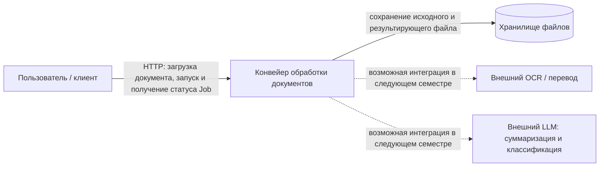
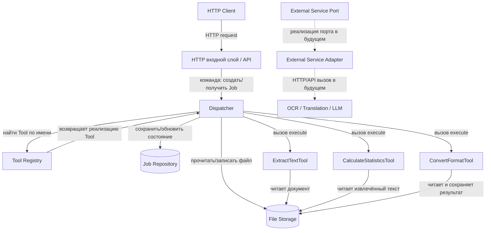

# Архитектура конвейера обработки документов

> Область работы: сервис принимает документ, создаёт Job и последовательно выполняет доступные операции обработки.
> Внешние сервисы OCR/перевода и LLM в этой версии не вызываются: в архитектуре показана точка расширения (порт и адаптер), но интеграция отложена до следующего семестра.

## 1. Контекст системы (C4 — Context)

**Смысл стрелок:** сплошные стрелки — runtime-вызовы/обмен данными; пунктирные — запланированные интеграционные зависимости, не активные в текущем объёме.

| Элемент | Ответственность | Что скрывает от соседей |
|---|---|---|
| Пользователь / клиент | Загружает документ, запускает обработку, проверяет Job | Скрывает пользовательский интерфейс и способ формирования запроса |
| Конвейер обработки документов | Принимает запросы, управляет Job и вызывает Tools | Скрывает внутреннюю последовательность обработки и реализацию Tools |
| Хранилище файлов | Хранит исходные и обработанные файлы | Скрывает формат хранения, пути и детали файловой системы |
| Внешний OCR / перевод | Потенциально распознаёт сканы и переводит текст | В будущем скроет API и особенности провайдера |
| Внешний LLM | Потенциально суммаризирует и классифицирует документы | В будущем скроет API модели, промпты и формат ответа |

## 2. Компоненты системы

**Смысл стрелок:** сплошные стрелки показывают runtime-вызовы или передачу данных. Пунктирные — направление зависимости/планируемую реализацию порта; внешняя интеграция не входит в текущую реализацию.

| Компонент | Ответственность | Что скрывает от соседей |
|---|---|---|
| HTTP Client | Отправляет запросы и получает ответы | Скрывает пользовательский интерфейс |
| HTTP входной слой | Проверяет структуру HTTP-запроса, преобразует его в команду | Скрывает HTTP/JSON от бизнес-логики |
| Dispatcher | Создаёт Job и координирует выполнение шагов | Скрывает порядок вызовов и обработку ошибок |
| Tool Registry | Регистрирует Tools и находит их по имени | Скрывает способ регистрации и конкретные классы |
| Job Repository | Сохраняет и читает состояние Job | Скрывает конкретную БД и формат хранения |
| File Storage | Хранит файлы и выдаёт ссылки/идентификаторы | Скрывает файловую систему или объектное хранилище |
| ExtractTextTool | Извлекает текст из поддерживаемого документа | Скрывает библиотеку парсинга и детали форматов |
| CalculateStatisticsTool | Считает статистику извлечённого текста | Скрывает алгоритмы подсчёта |
| ConvertFormatTool | Конвертирует документ в поддерживаемый формат | Скрывает библиотеку конвертации |
| External Service Port | Определяет внутренний интерфейс внешней функции | Скрывает провайдера от Dispatcher и Tools |
| External Service Adapter | В будущем преобразует внутренний вызов во внешний API | Скрывает протокол, авторизацию и формат провайдера |

## 3. Принятые границы текущей версии

- В текущем объёме используются локальные Tools: извлечение текста, подсчёт статистики, конвертация формата.
- OCR, перевод, суммаризация и классификация через LLM обозначены как возможные внешние возможности следующего семестра. Они не являются обязательными шагами текущего Job.
- Job выполняется синхронно в рамках запроса в базовой версии. Поэтому состояние `queued` предусмотрено для расширения, но обычный сценарий проходит `created → running`.
- Повторная отправка с тем же `Idempotency-Key` не создаёт второй Job.
